<div align="center">

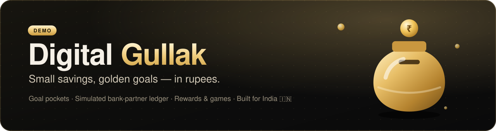

<br />

**An India-first goal-savings app in ₹ — the old clay *gullak*, rebuilt for UPI-era India.**
<br />
Goal pockets · a ledger built like a bank partner integration · rewards, games and quests · a black-and-gold UI that feels premium.

<br />


<br />


[**Screenshots**](#-screenshots) · [**Quick start**](#-quick-start) · [**Features**](#-features) · [**Architecture**](#-architecture) · [**Rewards**](#-gullak-rewards) · [**Security**](#-security) · [**Roadmap**](#-road-to-live-money)

</div>

---

> [!IMPORTANT]
> **This is a working demo that uses simulated money only.** It connects to no bank, UPI, payment, KYC or investment service. Every balance and transaction is labelled *Simulated*. The server **refuses to start** if anyone tries to turn on live money, and no live provider exists in the code to switch on.

## 🪔 Why Digital Gullak?

Almost every Indian home has had a **gullak**, a clay money-pot that turns spare coins into something you're saving *for*. The digital versions became "digital gold" apps. In **November 2025, SEBI cautioned the public** that digital gold sits outside its regulation and carries counterparty risk, and users then pulled money out in large numbers.

Digital Gullak goes the other way:

| | Typical "digital gold" gullak | **Digital Gullak** |
|---|---|---|
| What you hold | Grams of gold, market-priced | **Rupees**, in a bank partner's account |
| Value | Moves with gold prices | Shows **exactly what you saved** |
| Regulator | Outside SEBI's remit | Designed for a **regulated bank partner** |
| Returns | Implied | **Never promised.** Interest is shown only from real partner terms |
| Lock-ins | Varies | **None.** Withdraw any time |

---

## 📸 Screenshots

<table>
  <tr>
    <td width="66%">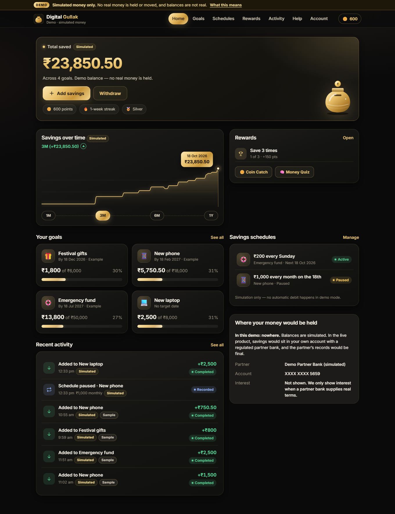</td>
    <td width="34%">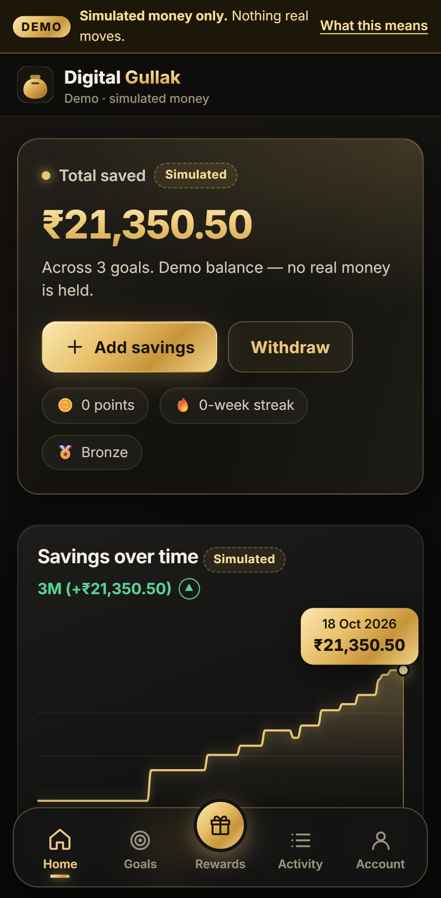</td>
  </tr>
  <tr>
    <td align="center"><b>Home dashboard</b>: count-up total, savings chart, goals, schedules</td>
    <td align="center"><b>Mobile</b>: floating glass navigation with a raised Rewards button</td>
  </tr>
  <tr>
    <td>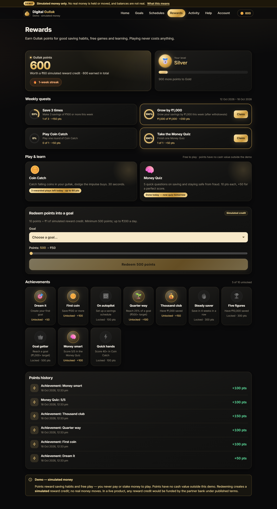</td>
    <td>
      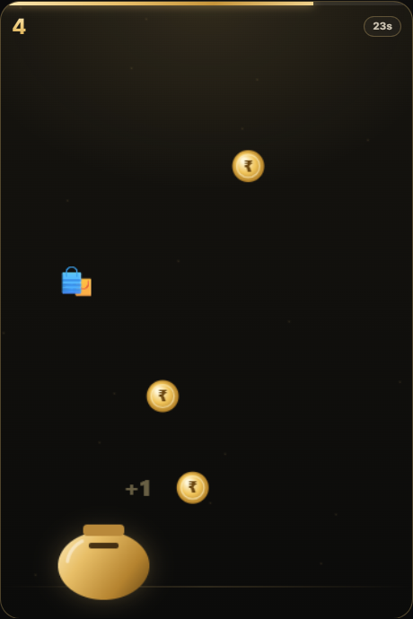
      <br /><br />
      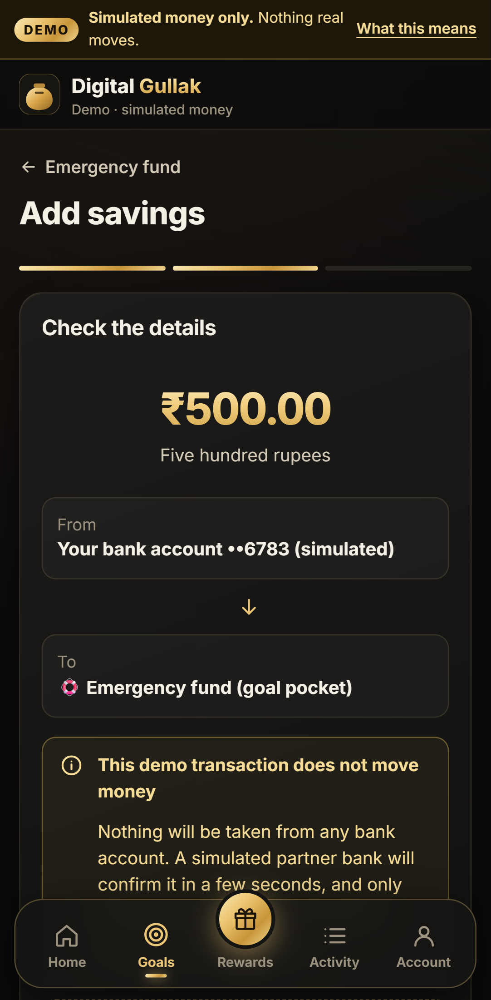
    </td>
  </tr>
  <tr>
    <td align="center"><b>Rewards hub</b>: points, levels, streaks, quests, achievements</td>
    <td align="center"><b>Coin Catch</b> and the <b>review-before-you-confirm</b> step</td>
  </tr>
  <tr>
    <td>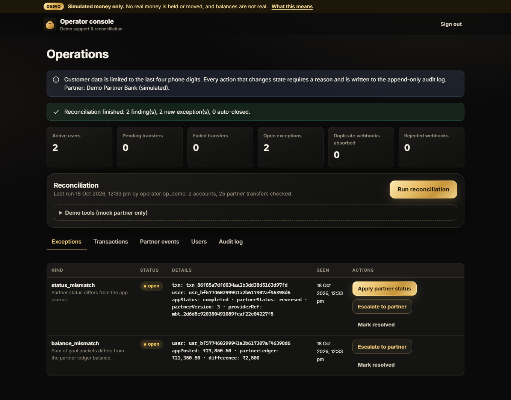</td>
    <td>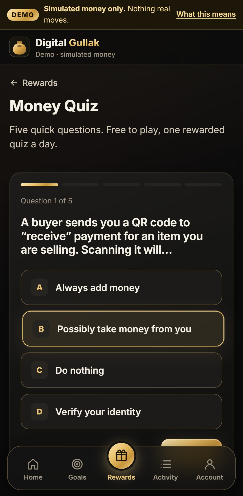</td>
  </tr>
  <tr>
    <td align="center"><b>Operator console</b>: reconciliation catching a lost partner webhook</td>
    <td align="center"><b>Money Quiz</b>: financial literacy and fraud safety</td>
  </tr>
</table>

<details>
<summary><b>Welcome screen</b> (mock OTP, clearly labelled)</summary>
<br />
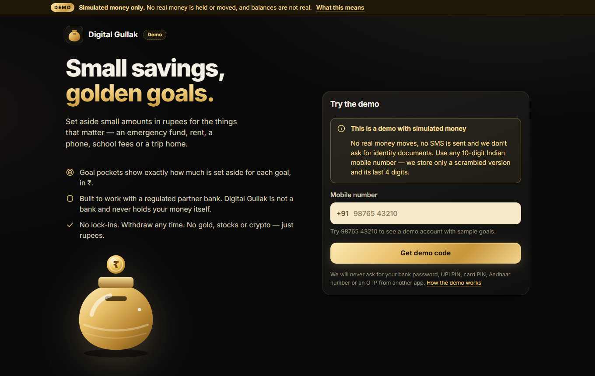
</details>

---

## ⚡ Quick start

> **Needs:** Node.js **22.13+** (it uses the built-in `node:sqlite`; tested on Node 25). No database server and no Docker.

```bash
git clone https://github.com/sarthakkandhare03/DigitalGullak.git
cd DigitalGullak
npm install
npm run setup     # writes .env with random secrets, runs migrations, seeds demo users
npm run dev       # 🚀 http://localhost:5173  (API on :8787)
```

| Try it as | Mobile number | What you'll see |
|---|---|---|
| 👩 **Asha** | `98765 43210` | Three example goals with history, an active and a paused schedule |
| 👨 **Ravi** | `91234 56780` | An empty account, handy for checking that users can't see each other's data |
| 🆕 Anyone | any 10-digit Indian mobile | A new user: start with example goals or start fresh |
| 🛡️ Operator | `/ops`, passcode `gullak-ops-demo` | Reconciliation, exceptions, partner events, audit log |

The **OTP appears on screen**; no SMS is ever sent.

<details>
<summary><b>All scripts</b></summary>

| Command | What it does |
|---|---|
| `npm run dev` | API (tsx watch) + Vite dev server with an `/api` proxy |
| `npm run build && npm start` | Production build served on a single port (`:8787`) |
| `npm test` | 42 Vitest tests: money maths, ledger, idempotency, ownership, webhooks, reconciliation, rewards, security |
| `npm run e2e` | Playwright end-to-end tests on mobile and desktop, using your installed Edge (`E2E_CHANNEL=chrome` for Chrome) |
| `npm run typecheck` | Strict TypeScript across server, shared code and web |
| `npm run db:migrate` / `db:seed` / `db:reset` | Database management |
| `README_SHOTS=1 npx playwright test readme-shots` | Regenerate the screenshots in this README |

</details>

---

## ✨ Features

### 💰 Saving
- **Goal pockets** for an emergency fund, rent, a phone, education, travel, festivals… Each has a target, an optional date, a progress bar and a suggested monthly amount.
- **Add savings and withdraw** in three steps: *amount → review → status*. The review step shows the amount **in words** ("Two lakh fifty thousand rupees"), where the money comes from and where it goes, and a clear *"this does not move money"* notice.
- **Honest statuses:** *Pending* until the (simulated) bank partner confirms. Success is never shown before confirmation. Failures say so plainly and leave the balance untouched.
- **Savings schedules** run daily, weekly or monthly. Consent starts **unticked**, and you can pause, resume or cancel. In demo mode they never debit anything; "Simulate next run" shows what a run would look like.
- **Activity feed** of contributions, withdrawals and schedule events, each with a full status timeline that is never edited.
- **Indian formatting everywhere:** ₹1,25,000.50 with lakh and crore grouping, and dates in IST.

### 🎮 Rewards and games
- **Gullak points**, **5 levels** (🥉 Bronze → 👑 Diamond) and a **weekly saving streak** 🔥
- **10 achievements** and **4 weekly quests** with animated progress rings
- **🧠 Money Quiz:** a daily 5-question quiz on saving, UPI safety and scam spotting
- **🪙 Coin Catch:** a 30-second canvas game where you catch coins and gold bars and dodge "impulse buys". **The server re-checks every score.**
- **Redeem points** into a goal as a *simulated* reward credit (10 points = ₹1)

### 🎨 Look and feel
- A **"Midnight Gold"** design system: gold gradients, glassy cards, cream input fields
- Count-up totals, page transitions, staggered cards, a gold sheen on buttons, confetti and toasts
- A **"Savings over time"** chart (1M/3M/6M/1Y) that you can explore by touch or keyboard
- **Accessible:** keyboard navigation, focus management, screen-reader labels, `prefers-reduced-motion` and forced-colours support

### 🛡️ Operator console
- KPIs, **reconciliation** against the partner's records, de-duplicated **exceptions**, a partner event log, and an **append-only audit log** that requires a reason for every action
- Demo drills: *replay a webhook*, *settle slow transfers*, *simulate a partner reversal whose webhook gets lost*

---

## 🏗️ Architecture

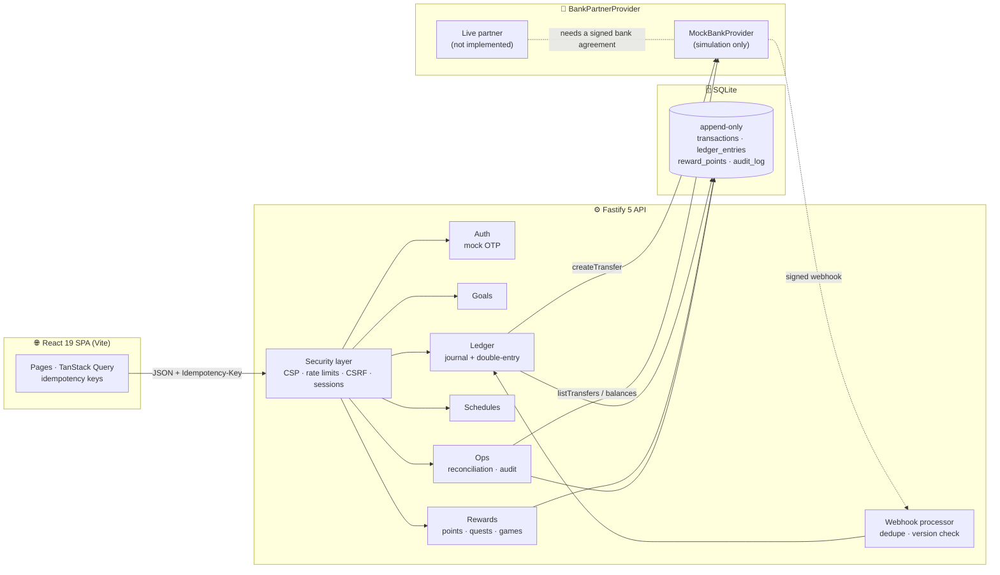

### How a simulated deposit works

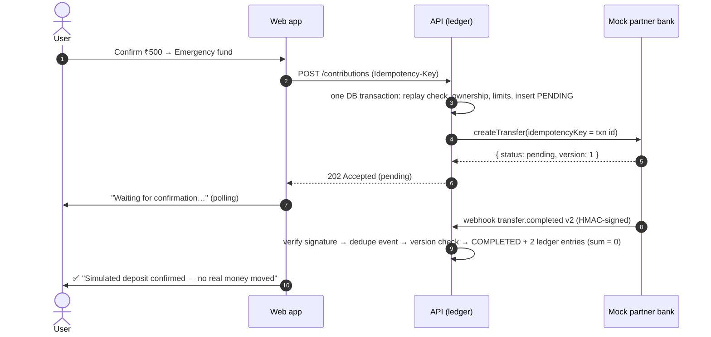

### Guarantees the code enforces

| Guarantee | How |
|---|---|
| **Integer paise only** | Strings are parsed straight to paise and formatted with integer arithmetic. There are no float operations on money anywhere. |
| **Records can't be edited** | SQLite **triggers** block `UPDATE` and `DELETE` on journal, ledger, events, points and audit rows. Corrections are new reversal entries. |
| **Valid state changes only** | A database trigger allows only `pending → completed / failed` and `completed → reversed`. |
| **No double spending** | Idempotency keys on every money action, deterministic keys for schedule runs, and partner calls keyed by the transaction id |
| **Withdrawal holds** | `available = posted − pending withdrawals`, checked inside one write transaction |
| **Partner is authoritative** | Reconciliation compares every transfer and balance against the partner. Operators apply the partner's status, and each fix is audited. |
| **Ownership** | Every query is scoped by `user_id`. Another user's resources return `404`, so the API doesn't reveal that they exist. |

📖 Deep dive: [`docs/ARCHITECTURE.md`](docs/ARCHITECTURE.md) · [`docs/IMPLEMENTATION_PLAN.md`](docs/IMPLEMENTATION_PLAN.md)

---

## 🎮 Gullak Rewards

> Reward **saving habits and learning**. Nobody ever pays or stakes anything to play, so no game is an "online money game" under India's **Online Gaming Act 2025**. There are also no games of chance: no spins, scratch cards or lotteries.

| Earn | Points | Anti-abuse |
|---|---|---|
| 🎯 Achievements (10) | 50–500 each, once | Sample data and reward credits never count |
| 📅 Weekly quests (4) | 50–200 | Net savings must cover the deposits, so deposit-then-withdraw farming doesn't work |
| 🧠 Money Quiz | 10 per correct answer, +50 for a perfect score | Answers stay on the server; one rewarded quiz a day |
| 🪙 Coin Catch | up to 60 per game | Server-issued seed and server-recomputed score; 3 rewarded plays a day |
| 🔁 Redeem | 10 points = ₹1 (simulated) | At least 500 points, at most ₹200 a day; points are refunded if the partner declines |

---

## 🔐 Security

<table>
<tr><td>🍪 <b>Sessions</b></td><td>httpOnly + SameSite=Strict cookies, only the hash of the token is stored, a 30-minute idle timeout and at most 5 sessions per user</td></tr>
<tr><td>🧱 <b>CSRF</b></td><td>SameSite=Strict, JSON-only bodies, an Origin allow-list, and Fetch Metadata (<code>Sec-Fetch-Site: cross-site</code> is refused)</td></tr>
<tr><td>🚦 <b>Rate limits</b></td><td>600 requests/min per IP overall · 10/min for OTP requests · 10/min for operator sign-in · 30/min for games and claims · plus limits per phone number</td></tr>
<tr><td>📜 <b>Headers</b></td><td>A strict CSP (no inline scripts, <code>frame-ancestors 'none'</code>), COOP/CORP, Permissions-Policy, HSTS over HTTPS, <code>X-Request-Id</code></td></tr>
<tr><td>✅ <b>Input</b></td><td>Zod validation with strict schemas (unknown fields rejected) and a 64 KB body limit</td></tr>
<tr><td>✍️ <b>Webhooks</b></td><td>HMAC-SHA256 over the raw body with a 5-minute timestamp window, constant-time comparison, de-duplication by event id, and stale or out-of-order events rejected by version</td></tr>
<tr><td>🙈 <b>Privacy</b></td><td>Phone numbers are stored only as an HMAC plus the last 4 digits. No IDs, no bank details. Users can export their data. Secrets are never logged.</td></tr>
<tr><td>📦 <b>Supply chain</b></td><td><code>npm audit</code>: 0 vulnerabilities</td></tr>
</table>

---

## 🧪 Testing

```text
✓ shared/money.test.ts     11 tests  (₹ formatting, lakh/crore words, IST schedules)
✓ server/test/api.test.ts  19 tests  (auth, idempotency, ownership, immutability, webhooks, reconciliation)
✓ server/test/rewards.test 12 tests  (quests, quiz, anti-cheat, redemption refunds, security headers, rate limits)
✓ e2e (Playwright)          6 tests  (every main flow on Pixel 7 + desktop, incl. a full Coin Catch round)
```

---

## 🗂️ Project structure

```text
shared/          money (integer paise) · IST dates · rewards rules · API types (used by both sides)
server/src/
  app.ts         Fastify setup: security headers, rate limits, CSRF, compression, static files
  config.ts      environment + the simulated-money guard 🔒
  db/            node:sqlite helpers · migration runner · migrations/*.sql (with integrity triggers)
  auth/          mock OTP · sessions · onboarding · export · account closure
  ledger/        journal state machine · double-entry postings · activity · insights
  rewards/       points ledger · achievements · quests · quiz bank · Coin Catch verification
  providers/     BankPartnerProvider interface · webhook processor · mock/ partner bank
  ops/           reconciliation · exceptions · audit log
web/src/         React app: pages, components (chart, toasts, gullak art), motion helpers
e2e/             Playwright specs + README screenshot generator
docs/            architecture, implementation plan, screenshots
```

---

## 🚀 Road to live money

Nothing here moves real money until a regulated partner is in place. Before going live:

- [ ] Signed agreement with a **bank or authorised provider**, and a reviewed fund flow (account ownership, whether pockets are app allocations or partner sub-accounts)
- [ ] A live `BankPartnerProvider`: accounts, balances, idempotent transfers, signed webhooks, settlement files
- [ ] Partner-run **KYC** (the app never collects identity documents)
- [ ] **UPI AutoPay / e-mandate** flow for schedules: AFA, a pre-debit notice at least 24 hours ahead, pause and revoke
- [ ] Partner-approved disclosures: where money is held, fees, interest (from real terms only), and DICGC wording only if the account structure qualifies
- [ ] Grievance officer and escalation path, including the RBI Integrated Ombudsman
- [ ] DPDP Rules 2025 compliance: consent records, retention, breach notification
- [ ] Rewards funded by the partner or a sponsor under published terms, with legal review
- [ ] Production platform: PostgreSQL, a DLT-registered SMS OTP, staff SSO with MFA, a secrets manager, monitoring

### 📚 Official references
[RBI PPI Directions](https://www.rbi.org.in/Scripts/NotificationUser.aspx?Id=12156) ·
[DICGC booklet](https://www.dicgc.org.in/sites/default/files/2025-02/dicgc-information-booklet.pdf) ·
[NPCI UPI AutoPay](https://www.npci.org.in/product/bhim) ·
[SEBI caution on digital gold](https://www.sebi.gov.in/media-and-notifications/press-releases/nov-2025/caution-to-public-regarding-dealing-in-digital-gold-_97676.html) ·
[RBI Ombudsman (CMS)](https://cms.rbi.org.in)

---

<div align="center">

**Built with ☕, 🪙 and a lot of respect for the humble clay gullak.**

<sub>Digital Gullak is a demonstration project. It is not a bank, holds no funds and makes no promise of returns.</sub>

</div>
